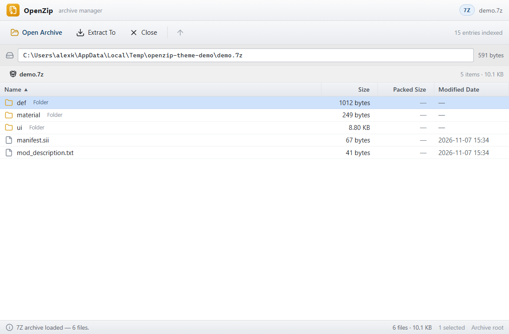
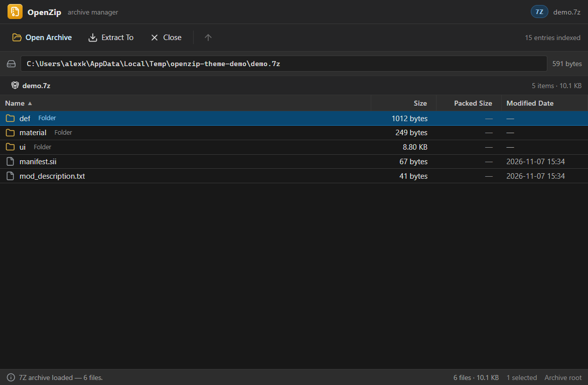
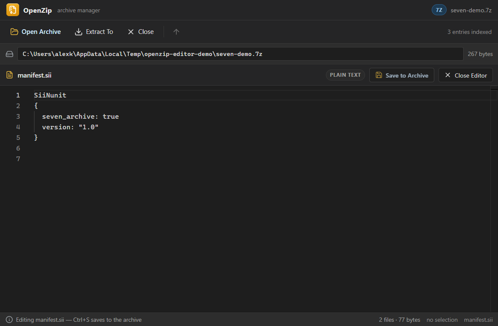
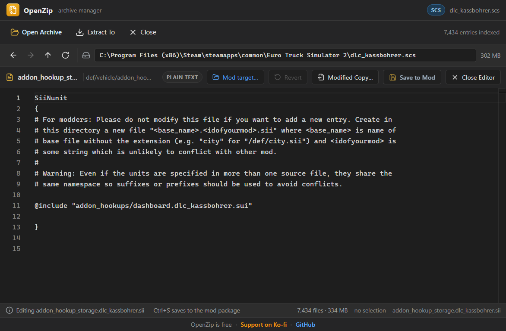
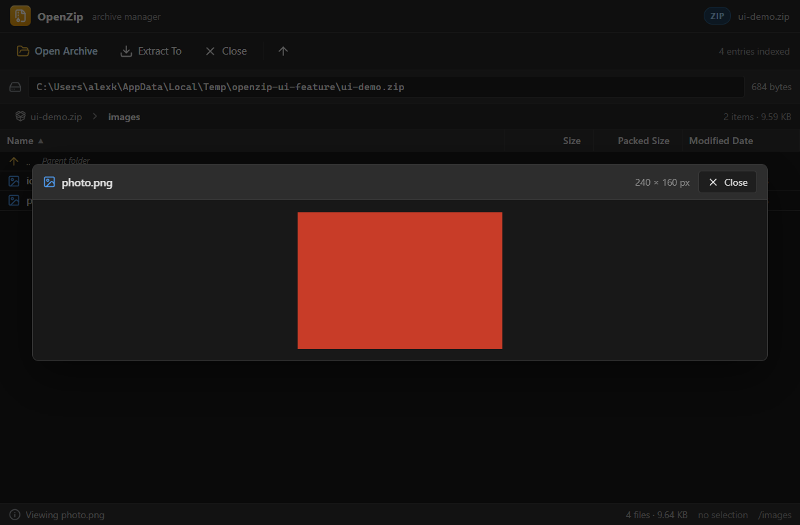

# OpenZip

A WinRAR-style desktop archive manager for Windows, built with **Electron + React + Vite**.

OpenZip browses and extracts **ZIP, RAR, 7z, TAR, GZ, BZ2, XZ, ISO, CAB** and every other format the
bundled 7-Zip engine understands — with **no WinRAR or 7-Zip installation required**. It also has a
dedicated path for **HashFS `.scs`** containers from **Euro Truck Simulator 2** and **American Truck
Simulator**.



## Download

Get the latest `OpenZip Setup <version>.exe` (installer) or `OpenZip Portable <version>.exe` from the
[Releases page](https://github.com/alexgokawa/OpenZip/releases). Windows only.

The builds are not code-signed, so Windows SmartScreen may show an "unknown publisher" warning on
first run. Choose **More info**, then **Run anyway**. You can also build the app yourself from source
(see below).

## Features

- Native **Open Archive** dialog for `rar`, `7z`, `tar`, `gz`, `bz2`, `xz`, `iso`, `cab`, `scs` and `zip`.
- Both file dialogs remember their last folder across restarts (`lastOpenDir` and `lastExtractDir` in
  `settings.json` under Electron's userData directory), with missing folders falling back safely.
- Detailed file table: name with folder/file icons, size, packed size, modified date.
- Sortable columns, multi-select (Ctrl / Shift), drill-down folder navigation with breadcrumbs.
- **Extract To** writes the whole archive, or only the selected entries, to a folder you pick.
- Bottom status bar with archive/file counts, live extraction progress, and clear error reporting.
- **Built-in Monaco editor** for text/config files, with `Ctrl+S` writing changes straight back into the archive.
- **Drag-and-drop injection** of files, folders and images into writable archives (or drop an archive to open it).
- **In-app image viewer** for PNG, JPEG, BMP, WEBP, ICO and GIF entries, with dimensions and Esc-to-close.
- **External links footer** with Ko-fi and GitHub links that open in the system browser via a validated
  `shell:openExternal` IPC handler.
- **Windows Explorer navigation** with Back/Forward history, Up, Refresh, breadcrumbs and shortcuts;
  the bar stays visible while editing or previewing images.
- **Follows the Windows light/dark theme in real time**, with a themed window background and no startup flash.
- Windows file associations for `.scs`, `.zip`, `.rar` and `.7z`, with command-line startup opening the archive.
- HashFS `.scs` archives are indexed natively (v2) so their real file tree is browsable and editable;
  archives without a usable tree can still be unpacked by the bundled SCS extractor.

## Theme support

OpenZip has a complete light and dark palette and follows Windows automatically:

- `nativeTheme.themeSource = 'system'` keeps Electron aligned with the OS.
- The window's `backgroundColor` is picked from `nativeTheme.shouldUseDarkColors` (`#1e1e1e` dark,
  `#f0f0f0` light) so no white flash appears while the renderer boots.
- `nativeTheme`'s `updated` event updates the native window background and sends `theme:changed` to the
  renderer.
- The renderer also watches `window.matchMedia('(prefers-color-scheme: dark)')`, so toggling Windows
  dark mode restyles the app instantly. Both paths update the same palette tokens in
  [`src/index.css`](src/index.css).

| Light | Dark |
| --- | --- |
|  |  |

## Built-in code editor

Double-click a text or configuration file in the archive to open it in an integrated
[Monaco](https://microsoft.github.io/monaco-editor/) editor tab — no external editor is launched.



- Editable extensions: `.sii`, `.sui`, `.mat`, `.def`, `.txt`, `.cfg`, `.ini`, `.json`, `.xml`,
  `.lua`, `.md`, `.log`, `.toml`, `.yaml`, `.js` and `.ts`.
- Language modes: JSON, XML, INI (also `.cfg`), Lua, Markdown, YAML, JavaScript, TypeScript, and
  plaintext for ETS2/ATS formats such as `.sii`, `.sui`, `.mat` and `.def`.
- The editor header shows the file name, a `*` dirty indicator, the language, **Save to Archive** and
  **Close Editor**. The editor follows the Windows light/dark theme (`vs-dark` / `light`).
- `Ctrl+S` (or **Save to Archive**) replaces the entry in place. The status bar confirms with
  `Saved & updated <file> inside archive`; unsaved changes prompt before closing.
- In-place writes are supported for **ZIP** (including ZIP-based `.scs` mods), **7z** and **TAR**.
  RAR, ISO, CAB and compressed streams are read-only — OpenZip shows a clear
  error instead of corrupting them. Binary entries and files over 20 MB are refused by the editor.

## Windows Explorer navigation

The address bar starts with a four-button navigation cluster: **Back**, **Forward**, **Up** and
**Refresh**. Folder visits and editor/image views are kept in a real history stack, so Forward can
restore a file or image you left. The bar remains visible while the Monaco editor or image viewer is
open.

| Action | Mouse / keyboard |
| --- | --- |
| Back | `←` button, `Alt+Left`, or `Backspace` (outside text fields) |
| Forward | `→` button or `Alt+Right` |
| Up one level | `↑` button or `Alt+Up` |
| Refresh archive | `↻` button or `F5` |
| Return from editor/image | `←`, `↑`, `Esc`, or the editor/image Close buttons |

Back/Up from the editor or image viewer prompts for unsaved changes, closes the overlay and returns to
the containing folder. Disabled navigation buttons are dimmed and non-interactive.

## Editing HashFS archives (ETS2/ATS)

OpenZip reads HashFS v2 archives natively (`SCS#`, CityHash64 paths, zlib entry/metadata tables), so
double-clicking a `.sii`/`.sui`/`.mat`/text file inside `base.scs`, a DLC or a map archive opens it in
the built-in editor. **The original game archive is opened read-only and is never modified.**



Saving uses one of two explicit modes:

1. **Save to Mod** (default) — writes a small ZIP package containing only the edited files at their
   original paths, e.g. `def/vehicle/trailer_owned/x/y.sii`, with a `.scs` extension. Ask for a target
   the first time and remember it per archive. A mod loaded above the original archive overrides just
   those files.
2. **Modified Copy…** — rebuilds a complete HashFS archive next to the original (or wherever you
   choose) with the edited files swapped in. Original data blocks are copied verbatim, so every
   unchanged non-packed file is byte-identical. This mode streams the copy and reports progress.

Editor behaviour:

- Edits stay in memory until saved; changed files show an **Edited** badge and the status bar counts
  them.
- **Revert** drops one file's edit, reloads the original bytes and rewrites the mod package without it.
- Saving again updates the same mod package; the original archive keeps its size, modified date and
  bytes.
- Binary assets (`.pmd`, `.pmg`, `.pmc`, `.tobj`, `.dds`, …) are listed but remain extract-only and
  explain why when double-clicked.
- HashFS v1, archives with no directory listing, and packed texture payloads are not decoded by the
  native reader; use **Extract To** for those.
- Some HashFS archives, for example mods locked by their author, can't be indexed and open as a single
  container. Extract To works only when the extractor can read them.

## Drag-and-drop injection

Drag files, folders or pictures onto the window while an archive is open. OpenZip shows a drop overlay,
asks `Add <N> item(s) to archive?`, copies the items into the currently browsed folder (or the archive
root), and refreshes the table.

- Writable: **ZIP** (including ZIP-based `.scs` files), **7z** and **TAR**.
- Read-only: HashFS `.scs`, **RAR**, **ISO**, CAB, compressed streams. The status bar reports
  `This archive format is read-only. Cannot inject files.`
- Dropping a single supported archive while a writable archive is open asks whether to **Add to archive**
  or **Open it**. With no archive open, or a read-only archive open, it opens directly.
- Folders are injected recursively with their directory structure preserved.

## Drag files out

Select one or more rows and drag them to the desktop, File Explorer or another application. OpenZip
pre-extracts the selection to `%TEMP%\openzip-drag-<session>` using the same engines as **Extract To**
(7-Zip, or the SCS extractor's `--paths` filter for HashFS), then starts a native Windows drag with the
app icon. Selected folders stay folders.

- Works for every readable format, including read-only RAR, ISO and HashFS `.scs` and compressed
  archives; only reads are performed.
- Automatic selection preparation is capped at **200 MB** of uncompressed entries. It is also skipped
  for Ctrl+A selections and whole top-level folders inside large archives. Above the cap, preparation
  starts only when you begin dragging, with progress in the status bar.
- Preparation also starts on row mousedown, so normal-sized files are ready by the time the drag
  begins. If preparation is still running, the status bar shows **Preparing files…** and then
  **Files ready — drag again to drop them.**
- Extracted files are kept for the whole archive session. New selections reuse them and extract only
  missing entries; files no longer selected are removed only after the session cache grows beyond
  512 MB.
- The per-session temp folder is deleted when the archive closes and on app quit. Leftover
  `openzip-drag-*`, `openzip-edit-*`, `openzip-add-*` and `openzip-nested-*` folders older than
  24 hours are removed at startup. Extracted paths are validated and cannot escape the session folder.

## Nested archives

Double-click a `.scs`, `.zip`, `.rar`, `.7z`, `.tar`, `.iso` or `.cab` entry inside an open archive.
OpenZip extracts just that entry to `%TEMP%\openzip-nested-<session>`, then opens it with the normal
archive reader, so nested HashFS `.scs` files get their directory tree too.

- Entries over **300 MB** ask for confirmation and show their size. Before extraction OpenZip checks
  that the temp drive has at least **2×** the entry size free.
- The address bar shows the chain, for example `outer.7z > inner.scs`. **Back** and **Up** at the
  nested archive root return to the outer archive at the folder where the entry was opened.
- Extracted nested files are cached for the session using the outer archive path, entry name, size and
  mtime. Reopening is instant; changing the outer archive invalidates the cache.
- If **both** archives are writable (ZIP, 7z, TAR, or a ZIP-based `.scs`), Save to Archive and Add
  files edit the extracted inner copy. When you go Back, close the archive or open another archive,
  OpenZip asks **Save changes to inner.zip inside outer.zip?** and writes the inner archive back with
  progress. The write-back first updates a temporary copy, verifies the entry and its new size, then
  replaces the original; failures leave the original untouched.
- The write-back warns first when the inner archive is over **300 MB** or the outer archive is a solid
  7z.
- Read-only nesting is kept when the outer archive is RAR, ISO, CAB or another read-only format, or when
  the inner archive is HashFS `.scs` or read-only. Save/Add are disabled with
  **This archive is opened from inside another archive. Extract it to edit it.** followed by
  **The inner archive is read-only.** or **The outer archive is read-only.**
- Browsing, previewing, extracting and dragging files out work in both cases, each nested archive with
  its own drag session.
- Nested folders are removed when the outer archive closes and on app quit, and are covered by the
  startup sweep.

## Image viewer

Double-click an image entry (`.png`, `.jpg`, `.jpeg`, `.bmp`, `.webp`, `.ico`, `.gif`) to open a centered
preview modal. The header shows the file name and actual pixel dimensions; the **Close** button or
`Esc` dismisses it. Image data is read in memory and returned as a data URL by the main process.



## Supported formats

| Family | Formats | Engine |
| --- | --- | --- |
| Archives | ZIP, RAR (RAR4/RAR5), 7z, TAR, CAB, ARJ, LZH, CPIO, XAR, WIM, … | 7-Zip (`node-7z`) |
| Compressed streams | GZ, BZ2, XZ, ZSTD, LZMA, Z | 7-Zip (`node-7z`) |
| Disk images | ISO, UDF, IMG, DMG, VHD, VHDX, QCOW2, … | 7-Zip (`node-7z`) |
| Game containers | HashFS v2 `.scs` (ETS2 / ATS) | Native reader; SCS extractor fallback |

The exact format list depends on the bundled 7-Zip build; anything 7-Zip can open, OpenZip can list and
extract. RAR and ISO support come from the full 7-Zip build, not from WinRAR.

## Requirements

- Node.js 20+
- Windows (both bundled tools are Windows executables)

## Run the desktop app

```bash
npm install
npm run electron:dev
```

`electron:dev` starts Vite on <http://localhost:5173>, waits for the port, then launches Electron.

> If your shell exports `ELECTRON_RUN_AS_NODE=1`, Electron will start as plain Node and fail to load
> its IPC APIs. Clear the variable before launching (`Remove-Item Env:ELECTRON_RUN_AS_NODE` in
> PowerShell).

## Scripts

| Script | Description |
| --- | --- |
| `npm run electron:dev` | Vite + Electron development session |
| `npm run dev` | Vite dev server only (browser preview) |
| `npm run build` | Type-check and build the renderer into `dist/` |
| `npm run build:app` | Build the renderer and package Windows installer + portable EXE |
| `npm run dist:win` | Same packaging run, producing `OpenZip Setup <version>.exe` and `OpenZip Portable <version>.exe` |
| `npm run lint` | ESLint over the whole project |
| `npm run preview` | Preview the production renderer build |

## Packaging (Windows)

```bash
npm run dist:win
```

This runs the production renderer build and then `electron-builder --win`. Outputs land in `release/`:

- `OpenZip Setup <version>.exe` — NSIS installer (not one-click; lets the user choose the install folder,
  creates desktop and Start-menu shortcuts, registers `.scs`, `.zip`, `.rar` and `.7z` file
  associations).
- `OpenZip Portable <version>.exe` — portable, self-extracting build.
- `win-unpacked/` — the unpacked app used for local testing, under `release/win-unpacked/`.

Packaging details:

- `appId` is `com.openzip.app`, product name `OpenZip`, icon [`docs/icon.ico`](docs/icon.ico).
- `fileAssociations` registers SCS, ZIP, RAR and 7z archives. Launching OpenZip with an archive path
  (including Windows "Open with") loads it automatically through `archive:initialPath`.
- `bin/**/*` is listed under `asarUnpack`, so `7z.exe`, `7z.dll` and
  `extractor.exe` stay outside `app.asar` and remain executable. The main process resolves them from
  `process.resourcesPath/app.asar.unpacked/bin` when packaged.
- The `files` list keeps the Vite renderer build at `dist/**/*`; installers and unpacked output go to
  `release/`, so no recursive packaging exclusions are needed.
- The production renderer uses relative asset URLs (`base: './'`) so `file://` loading inside the
  packaged app works.
- Renderer-only packages (React, Monaco, Lucide) are devDependencies because Vite bundles them; only
  `node-7z`, `adm-zip` and `7zip-bin` remain production dependencies.
- Builds are unsigned unless a Windows code-signing certificate is configured; the build log reports
  signing as skipped.

## How archives are handled

| Input | Detection | Engine |
| --- | --- | --- |
| `.zip`, `.rar`, `.7z`, `.tar`, `.gz`, `.bz2`, `.xz`, `.iso`, `.cab`, … | read/list with 7-Zip | `node-7z` |
| `.scs` (HashFS v2) | file starts with the ASCII magic `SCS#` | native `scs-hashfs.cjs` reader |
| `.scs` without a usable tree | 7-Zip cannot list it | falls back to the SCS extractor |

The main process ([`electron.cjs`](electron.cjs)) exposes these IPC handlers:

- `dialog:openArchive` — native file picker with filters for every supported extension.
- `dialog:selectOutputDir` — native folder picker used by **Extract To**.
- `archive:read` — detects HashFS by magic, otherwise lists the archive with
  `Seven.list()` and returns entry names, sizes, packed sizes and dates before anything is extracted.
- `archive:extract` — extracts with `Seven.extractFull()`; selected entries are passed as 7-Zip
  targets. HashFS archives keep routing to the bundled SCS extractor.
- `archive:readFile` — loads one text entry in memory for the built-in editor.
- `archive:saveFile` — writes an edited entry back into ZIP/7z/TAR archives.
- `archive:readImage` — returns an image entry as a base64 data URL.
- `archive:addFiles` — injects dropped files/folders into ZIP/7z/TAR archives.
- `archive:initialPath` — once-only handoff of an archive path passed on the command line.

Extraction progress (7-Zip percentage plus extracted-file count) is streamed to the renderer over
`archive:progress`.

### Bundled engines

- **`bin/7z/7z.exe` + `bin/7z/7z.dll`** — full 7-Zip 24.09 (LGPL, plus the unRAR restriction noted in
  [`bin/7z/License.txt`](bin/7z/License.txt)). This is what makes RAR, ISO, CAB and the long tail of
  formats work without installing anything.
  - `7zip-bin` is installed and used as an automatic fallback, but its standalone `7za.exe` build
    supports only 7z/zip/tar/gz/bz2/xz — **not RAR or ISO** — so the full build is bundled.
  - `node-7z` drives the engine for both listing and extraction, with UTF-8 console output enabled so
    non-ASCII filenames round-trip correctly.
- **`bin/extractor.exe`** — the SCS extractor, [sk-zk's Extractor](https://github.com/sk-zk/Extractor)
  (GPL-2.0, unmodified). OpenZip also accepts the legacy file name `scs_extractor.exe`. It probes
  the extractor's `--help` output and supports both the legacy `scs_extractor <archive> <output_dir>` call and the
newer `<archive> --dest=<output_dir>` CLI. Archives that report *"Top level directory is
  missing/empty"* are retried once with `--deep`.

Extraction always overwrites existing files (`-aoa`) and 7-Zip's stdin is closed so password or
overwrite prompts become clean errors instead of hangs.

## Project structure

```
electron.cjs        Electron main process, IPC handlers, 7-Zip/SCS/file-editing engines
scs-hashfs.cjs      Native HashFS v2 reader and modified-copy writer
app-settings.cjs    Persisted last-open / last-extract folders
temp-cleanup.cjs    Startup sweep for stale OpenZip temp folders
src/App.tsx         WinRAR-style UI, editor state and renderer-side IPC wiring
src/App.css         Application chrome, file-table and editor styling
src/EditorPane.tsx  Monaco editor pane, bundled workers and theme setup
bin/7z/             Bundled full 7-Zip engine (7z.exe, 7z.dll, license)
bin/                Bundled SCS extractor (extractor.exe)
licenses/           Full license texts for bundled third-party programs
scripts/            Self-contained smoke and HashFS regression tests
docs/               Screenshots
```

## Smoke test

The archive handlers can be exercised without opening a window:

```bash
node scripts/smoke-test.cjs
```

The test creates ZIP, 7z, TAR and TAR.GZ fixtures in a temp directory and verifies listing, metadata,
full/selective extraction, editor `readFile`/`saveFile` for ZIP/7z/TAR, drag-and-drop `addFiles`
injection into ZIP/7z, image data URLs, startup-argument handling, binary rejection, path-traversal
protection, HashFS read-only injection, SCS extractor error reporting, empty archives and corrupt
archives. RAR cannot be created by 7-Zip, so a real RAR fixture can be supplied explicitly:

```bash
$env:OPENZIP_RAR_FIXTURE = "C:\path\to\sample.rar"
node scripts/smoke-test.cjs
```

## HashFS regression test

```bash
npm run test:hashfs
```

This uses a real installed HashFS v2 archive (by default ETS2's `dlc_daf_tuning_pack.scs`, with
fallbacks) and verifies native listing, editing a `.sii`, saving a mod package that contains only that
file, reopening the mod as a ZIP, writing a full modified copy, and that **all 1,435 unchanged
non-packed files are byte-identical**. It also confirms the original archive's size, modified date and
SHA-256 do not change, and that the official SCS extractor can read the modified copy.

Set `OPENZIP_HASHFS_ARCHIVE` to test a different archive:

```bash
$env:OPENZIP_HASHFS_ARCHIVE = "C:\path\to\base.scs"
npm run test:hashfs
```

## License and credits

OpenZip's source code is released under the [MIT License](LICENSE).

OpenZip bundles two unmodified third-party programs, which keep their own licenses. Details and
license texts are in [THIRD-PARTY-NOTICES.md](THIRD-PARTY-NOTICES.md):

- **[Extractor](https://github.com/sk-zk/Extractor)** by sk-zk (GPL-2.0), which unpacks ETS2/ATS
  HashFS `.scs` archives. OpenZip is not affiliated with or endorsed by sk-zk.
- **[7-Zip](https://www.7-zip.org)** by Igor Pavlov (LGPL, with the unRAR restriction), which handles
  ZIP, RAR, 7z and the other archive formats.

## Support

OpenZip is free and made for the SCS modding community. If it saves you time, you can support further
tools on [Ko-fi](https://ko-fi.com/gokawa).

Made by [alexgokawa](https://github.com/alexgokawa).
